<div align="center">

<p>
<picture>
  <source media="(max-width: 600px)" srcset=".github/assets/header-compact.svg">
  
</picture>
</p>

<a href="https://www.hackingwithswift.com/100/swiftui"></a>


Mein Lerntagebuch zur **100 Days of SwiftUI**-Challenge von Paul Hudson.<br>
Jeder Kurstag bekommt einen eigenen Ordner – vom ersten `let` bis zur fertigen App.

[Fortschritt](#fortschritt) · [Tages-Tracker](#tages-tracker) · [Projekte](#projekte) · [Aufbau & Ablauf](#aufbau--ablauf)

</div>

## Fortschritt

<!-- progress:start -->
<picture>
  <source media="(max-width: 600px) and (prefers-color-scheme: dark)" srcset=".github/assets/progress-dark-compact.svg">
  <source media="(max-width: 600px)" srcset=".github/assets/progress-light-compact.svg">
  <source media="(prefers-color-scheme: dark)" srcset=".github/assets/progress-dark.svg">
  
</picture>

<p align="center"><b>Als Nächstes:</b> Tag 10 · <a href="https://www.hackingwithswift.com/100/swiftui/10">Structs, computed properties, and property observers</a></p>
<!-- progress:end -->

## Tages-Tracker

Alle 100 Tage, gegliedert wie im Kurs. Ein Tag wird automatisch abgehakt, sobald sein Ordner in [`Days/`](Days/) liegt.

<!-- tracker:start -->
<details open>
<summary>🟠 <b>Swift-Grundlagen</b> · Tag 1–15 · 9/15</summary>

| Tag | Thema | Erledigt |
|:---:|:------|:------:|
| 1 | [Variables, constants, strings, and numbers](https://www.hackingwithswift.com/100/swiftui/1) | [✅ 04.10.2026](Days/Day%20001%20%E2%80%93%20Variables%2C%20constants%2C%20strings%2C%20and%20numbers/ "Code von Tag 1") |
| 2 | [Booleans, string interpolation, and checkpoint 1](https://www.hackingwithswift.com/100/swiftui/2) | [✅ 04.10.2026](Days/Day%20002%20%E2%80%93%20Booleans%2C%20string%20interpolation%2C%20and%20checkpoint%201/ "Code von Tag 2") |
| 3 | [Arrays, dictionaries, sets, and enums](https://www.hackingwithswift.com/100/swiftui/3) | [✅ 07.10.2026](Days/Day%20003%20%E2%80%93%20Arrays%2C%20dictionaries%2C%20sets%2C%20and%20enums/ "Code von Tag 3") |
| 4 | [Type annotations and checkpoint 2](https://www.hackingwithswift.com/100/swiftui/4) | [✅ 07.10.2026](Days/Day%20004%20%E2%80%93%20Type%20annotations%20and%20checkpoint%202/ "Code von Tag 4") |
| 5 | [If, switch, and the ternary operator](https://www.hackingwithswift.com/100/swiftui/5) | [✅ 10.10.2026](Days/Day%20005%20%E2%80%93%20If%2C%20switch%2C%20and%20the%20ternary%20operator/ "Code von Tag 5") |
| 6 | [Loops, summary, and checkpoint 3](https://www.hackingwithswift.com/100/swiftui/6) | [✅ 13.10.2026](Days/Day%20006%20%E2%80%93%20Loops%2C%20summary%2C%20and%20checkpoint%203/ "Code von Tag 6") |
| 7 | [Functions, part one](https://www.hackingwithswift.com/100/swiftui/7) | [✅ 18.10.2026](Days/Day%20007%20%E2%80%93%20Functions%2C%20parameters%2C%20and%20return%20values/ "Code von Tag 7") |
| 8 | [Default values, throwing functions, and checkpoint 4](https://www.hackingwithswift.com/100/swiftui/8) | [✅ 19.10.2026](Days/Day%20008%20%E2%80%93%20Default%20values%2C%20throwing%20functions%2C%20and%20checkpoint%204/ "Code von Tag 8") |
| 9 | [Closures, passing functions into functions, and checkpoint 5](https://www.hackingwithswift.com/100/swiftui/9) | [✅ 20.10.2026](Days/Day%20009%20%E2%80%93%20Closures%2C%20passing%20functions%20into%20functions%2C%20and%20checkpoint%205/ "Code von Tag 9") |
| 10 | [Structs, computed properties, and property observers](https://www.hackingwithswift.com/100/swiftui/10) | 🟠 |
| 11 | [Access control, static properties and methods, and checkpoint 6](https://www.hackingwithswift.com/100/swiftui/11) |  |
| 12 | [Classes, inheritance, and checkpoint 7](https://www.hackingwithswift.com/100/swiftui/12) |  |
| 13 | [Protocols, extensions, and checkpoint 8](https://www.hackingwithswift.com/100/swiftui/13) |  |
| 14 | [Optionals, nil coalescing, and checkpoint 9](https://www.hackingwithswift.com/100/swiftui/14) |  |
| 15 | [Swift review](https://www.hackingwithswift.com/100/swiftui/15) |  |

</details>
<details>
<summary>⚪ <b>Projekte 1–3</b> – WeSplit, Guess the Flag, Views and Modifiers · Tag 16–25 · 0/10</summary>

| Tag | Thema | Erledigt |
|:---:|:------|:------:|
| 16 | [WeSplit · Teil 1/3](https://www.hackingwithswift.com/100/swiftui/16) |  |
| 17 | [WeSplit · Teil 2/3](https://www.hackingwithswift.com/100/swiftui/17) |  |
| 18 | [WeSplit · Teil 3/3](https://www.hackingwithswift.com/100/swiftui/18) |  |
| 19 | 🎯 [Challenge Day](https://www.hackingwithswift.com/100/swiftui/19) · Einheiten-Umrechner |  |
| 20 | [Guess the Flag · Teil 1/3](https://www.hackingwithswift.com/100/swiftui/20) |  |
| 21 | [Guess the Flag · Teil 2/3](https://www.hackingwithswift.com/100/swiftui/21) |  |
| 22 | [Guess the Flag · Teil 3/3](https://www.hackingwithswift.com/100/swiftui/22) |  |
| 23 | [Views and Modifiers · Teil 1/2](https://www.hackingwithswift.com/100/swiftui/23) |  |
| 24 | [Views and Modifiers · Teil 2/2](https://www.hackingwithswift.com/100/swiftui/24) |  |
| 25 | 🏆 [Meilenstein: Projekte 1–3](https://www.hackingwithswift.com/100/swiftui/25) · Schere, Stein, Papier |  |

</details>
<details>
<summary>⚪ <b>Projekte 4–6</b> – BetterRest, Word Scramble, Animation · Tag 26–35 · 0/10</summary>

| Tag | Thema | Erledigt |
|:---:|:------|:------:|
| 26 | [BetterRest · Teil 1/3](https://www.hackingwithswift.com/100/swiftui/26) |  |
| 27 | [BetterRest · Teil 2/3](https://www.hackingwithswift.com/100/swiftui/27) |  |
| 28 | [BetterRest · Teil 3/3](https://www.hackingwithswift.com/100/swiftui/28) |  |
| 29 | [Word Scramble · Teil 1/3](https://www.hackingwithswift.com/100/swiftui/29) |  |
| 30 | [Word Scramble · Teil 2/3](https://www.hackingwithswift.com/100/swiftui/30) |  |
| 31 | [Word Scramble · Teil 3/3](https://www.hackingwithswift.com/100/swiftui/31) |  |
| 32 | [Animation · Teil 1/3](https://www.hackingwithswift.com/100/swiftui/32) |  |
| 33 | [Animation · Teil 2/3](https://www.hackingwithswift.com/100/swiftui/33) |  |
| 34 | [Animation · Teil 3/3](https://www.hackingwithswift.com/100/swiftui/34) |  |
| 35 | 🏆 [Meilenstein: Projekte 4–6](https://www.hackingwithswift.com/100/swiftui/35) · Einmaleins-Lernspiel |  |

</details>
<details>
<summary>⚪ <b>Projekte 7–9</b> – iExpense, Moonshot, Navigation · Tag 36–48 · 0/13</summary>

| Tag | Thema | Erledigt |
|:---:|:------|:------:|
| 36 | [iExpense · Teil 1/3](https://www.hackingwithswift.com/100/swiftui/36) |  |
| 37 | [iExpense · Teil 2/3](https://www.hackingwithswift.com/100/swiftui/37) |  |
| 38 | [iExpense · Teil 3/3](https://www.hackingwithswift.com/100/swiftui/38) |  |
| 39 | [Moonshot · Teil 1/4](https://www.hackingwithswift.com/100/swiftui/39) |  |
| 40 | [Moonshot · Teil 2/4](https://www.hackingwithswift.com/100/swiftui/40) |  |
| 41 | [Moonshot · Teil 3/4](https://www.hackingwithswift.com/100/swiftui/41) |  |
| 42 | [Moonshot · Teil 4/4](https://www.hackingwithswift.com/100/swiftui/42) |  |
| 43 | [Navigation · Teil 1/4](https://www.hackingwithswift.com/100/swiftui/43) |  |
| 44 | [Navigation · Teil 2/4](https://www.hackingwithswift.com/100/swiftui/44) |  |
| 45 | [Navigation · Teil 3/4](https://www.hackingwithswift.com/100/swiftui/45) |  |
| 46 | [Navigation · Teil 4/4](https://www.hackingwithswift.com/100/swiftui/46) |  |
| 47 | 🏆 [Meilenstein: Projekte 7–9](https://www.hackingwithswift.com/100/swiftui/47) · Gewohnheiten-Tracker |  |
| 48 | [Expanding your horizons](https://www.hackingwithswift.com/100/swiftui/48) |  |

</details>
<details>
<summary>⚪ <b>Projekte 10–12</b> – Cupcake Corner, Bookworm, SwiftData · Tag 49–61 · 0/13</summary>

| Tag | Thema | Erledigt |
|:---:|:------|:------:|
| 49 | [Cupcake Corner · Teil 1/4](https://www.hackingwithswift.com/100/swiftui/49) |  |
| 50 | [Cupcake Corner · Teil 2/4](https://www.hackingwithswift.com/100/swiftui/50) |  |
| 51 | [Cupcake Corner · Teil 3/4](https://www.hackingwithswift.com/100/swiftui/51) |  |
| 52 | [Cupcake Corner · Teil 4/4](https://www.hackingwithswift.com/100/swiftui/52) |  |
| 53 | [Bookworm · Teil 1/4](https://www.hackingwithswift.com/100/swiftui/53) |  |
| 54 | [Bookworm · Teil 2/4](https://www.hackingwithswift.com/100/swiftui/54) |  |
| 55 | [Bookworm · Teil 3/4](https://www.hackingwithswift.com/100/swiftui/55) |  |
| 56 | [Bookworm · Teil 4/4](https://www.hackingwithswift.com/100/swiftui/56) |  |
| 57 | [SwiftData · Teil 1/3](https://www.hackingwithswift.com/100/swiftui/57) |  |
| 58 | [SwiftData · Teil 2/3](https://www.hackingwithswift.com/100/swiftui/58) |  |
| 59 | [SwiftData · Teil 3/3](https://www.hackingwithswift.com/100/swiftui/59) |  |
| 60 | 🏆 [Meilenstein: Projekte 10–12](https://www.hackingwithswift.com/100/swiftui/60) · FriendFace |  |
| 61 | 🏆 [Time for SwiftData](https://www.hackingwithswift.com/100/swiftui/61) |  |

</details>
<details>
<summary>⚪ <b>Projekte 13–15</b> – Instafilter, BucketList, Accessibility · Tag 62–78 · 0/17</summary>

| Tag | Thema | Erledigt |
|:---:|:------|:------:|
| 62 | [Instafilter · Teil 1/6](https://www.hackingwithswift.com/100/swiftui/62) |  |
| 63 | [Instafilter · Teil 2/6](https://www.hackingwithswift.com/100/swiftui/63) |  |
| 64 | [Instafilter · Teil 3/6](https://www.hackingwithswift.com/100/swiftui/64) |  |
| 65 | [Instafilter · Teil 4/6](https://www.hackingwithswift.com/100/swiftui/65) |  |
| 66 | [Instafilter · Teil 5/6](https://www.hackingwithswift.com/100/swiftui/66) |  |
| 67 | [Instafilter · Teil 6/6](https://www.hackingwithswift.com/100/swiftui/67) |  |
| 68 | [BucketList · Teil 1/6](https://www.hackingwithswift.com/100/swiftui/68) |  |
| 69 | [BucketList · Teil 2/6](https://www.hackingwithswift.com/100/swiftui/69) |  |
| 70 | [BucketList · Teil 3/6](https://www.hackingwithswift.com/100/swiftui/70) |  |
| 71 | [BucketList · Teil 4/6](https://www.hackingwithswift.com/100/swiftui/71) |  |
| 72 | [BucketList · Teil 5/6](https://www.hackingwithswift.com/100/swiftui/72) |  |
| 73 | [BucketList · Teil 6/6](https://www.hackingwithswift.com/100/swiftui/73) |  |
| 74 | [Accessibility · Teil 1/3](https://www.hackingwithswift.com/100/swiftui/74) |  |
| 75 | [Accessibility · Teil 2/3](https://www.hackingwithswift.com/100/swiftui/75) |  |
| 76 | [Accessibility · Teil 3/3](https://www.hackingwithswift.com/100/swiftui/76) |  |
| 77 | 🏆 [Meilenstein: Projekte 13–15](https://www.hackingwithswift.com/100/swiftui/77) · Fotos benennen |  |
| 78 | 🏆 [Time for MapKit](https://www.hackingwithswift.com/100/swiftui/78) |  |

</details>
<details>
<summary>⚪ <b>Projekte 16–18</b> – Hot Prospects, Flashzilla, Layout and Geometry · Tag 79–95 · 0/17</summary>

| Tag | Thema | Erledigt |
|:---:|:------|:------:|
| 79 | [Hot Prospects · Teil 1/7](https://www.hackingwithswift.com/100/swiftui/79) |  |
| 80 | [Hot Prospects · Teil 2/7](https://www.hackingwithswift.com/100/swiftui/80) |  |
| 81 | [Hot Prospects · Teil 3/7](https://www.hackingwithswift.com/100/swiftui/81) |  |
| 82 | [Hot Prospects · Teil 4/7](https://www.hackingwithswift.com/100/swiftui/82) |  |
| 83 | [Hot Prospects · Teil 5/7](https://www.hackingwithswift.com/100/swiftui/83) |  |
| 84 | [Hot Prospects · Teil 6/7](https://www.hackingwithswift.com/100/swiftui/84) |  |
| 85 | [Hot Prospects · Teil 7/7](https://www.hackingwithswift.com/100/swiftui/85) |  |
| 86 | [Flashzilla · Teil 1/6](https://www.hackingwithswift.com/100/swiftui/86) |  |
| 87 | [Flashzilla · Teil 2/6](https://www.hackingwithswift.com/100/swiftui/87) |  |
| 88 | [Flashzilla · Teil 3/6](https://www.hackingwithswift.com/100/swiftui/88) |  |
| 89 | [Flashzilla · Teil 4/6](https://www.hackingwithswift.com/100/swiftui/89) |  |
| 90 | [Flashzilla · Teil 5/6](https://www.hackingwithswift.com/100/swiftui/90) |  |
| 91 | [Flashzilla · Teil 6/6](https://www.hackingwithswift.com/100/swiftui/91) |  |
| 92 | [Layout and Geometry · Teil 1/3](https://www.hackingwithswift.com/100/swiftui/92) |  |
| 93 | [Layout and Geometry · Teil 2/3](https://www.hackingwithswift.com/100/swiftui/93) |  |
| 94 | [Layout and Geometry · Teil 3/3](https://www.hackingwithswift.com/100/swiftui/94) |  |
| 95 | 🏆 [Meilenstein: Projekte 16–18](https://www.hackingwithswift.com/100/swiftui/95) · Würfel-App |  |

</details>
<details>
<summary>⚪ <b>Projekt 19 & Finale</b> – SnowSeeker · Tag 96–100 · 0/5</summary>

| Tag | Thema | Erledigt |
|:---:|:------|:------:|
| 96 | [SnowSeeker · Teil 1/4](https://www.hackingwithswift.com/100/swiftui/96) |  |
| 97 | [SnowSeeker · Teil 2/4](https://www.hackingwithswift.com/100/swiftui/97) |  |
| 98 | [SnowSeeker · Teil 3/4](https://www.hackingwithswift.com/100/swiftui/98) |  |
| 99 | [SnowSeeker · Teil 4/4](https://www.hackingwithswift.com/100/swiftui/99) |  |
| 100 | 🎓 [Final Exam](https://www.hackingwithswift.com/100/swiftui/100) · 100 Fragen & Zertifikat |  |

</details>
<!-- tracker:end -->

## Projekte

Alle 19 Kursprojekte – dazwischen Challenges und Meilensteine, bei denen ich ganz ohne Anleitung eine eigene App baue.

<!-- projects:start -->
| | Projekt | Worum es geht | Tage | Status |
|:---:|:------|:------|:---:|:---:|
| 1 | **WeSplit** | Rechnung & Trinkgeld aufteilen | 16–18 |  |
| 🎯 | **Challenge Day** | Einheiten-Umrechner | 19 |  |
| 2 | **Guess the Flag** | Flaggen-Quiz | 20–22 |  |
| 3 | **Views and Modifiers** | Wie Views & Modifier funktionieren | 23–24 |  |
| 🏆 | **Meilenstein 1–3** | Schere, Stein, Papier | 25 |  |
| 4 | **BetterRest** | Schlafenszeit per Core ML berechnen | 26–28 |  |
| 5 | **Word Scramble** | Wörter aus einem Wort bilden | 29–31 |  |
| 6 | **Animation** | Animationen & Übergänge | 32–34 |  |
| 🏆 | **Meilenstein 4–6** | Einmaleins-Lernspiel | 35 |  |
| 7 | **iExpense** | Ausgaben erfassen | 36–38 |  |
| 8 | **Moonshot** | Apollo-Missionen entdecken | 39–42 |  |
| 9 | **Navigation** | NavigationStack im Detail | 43–46 |  |
| 🏆 | **Meilenstein 7–9** | Gewohnheiten-Tracker | 47 |  |
| 10 | **Cupcake Corner** | Bestellen über eine Web-API | 49–52 |  |
| 11 | **Bookworm** | Bücher bewerten mit SwiftData | 53–56 |  |
| 12 | **SwiftData** | Filtern, Sortieren & Beziehungen | 57–59 |  |
| 🏆 | **Meilenstein 10–12** | FriendFace – mit SwiftData | 60–61 |  |
| 13 | **Instafilter** | Fotos mit Core Image filtern | 62–67 |  |
| 14 | **BucketList** | Orte auf der Karte sammeln | 68–73 |  |
| 15 | **Accessibility** | Apps für alle bedienbar machen | 74–76 |  |
| 🏆 | **Meilenstein 13–15** | Fotos benennen – mit MapKit | 77–78 |  |
| 16 | **Hot Prospects** | Kontakte per QR-Code teilen | 79–85 |  |
| 17 | **Flashzilla** | Lernkarten mit Gesten & Timern | 86–91 |  |
| 18 | **Layout and Geometry** | Layout-System & GeometryReader | 92–94 |  |
| 🏆 | **Meilenstein 16–18** | Würfel-App | 95 |  |
| 19 | **SnowSeeker** | Skigebiete für iPhone & iPad | 96–99 |  |
| 🎓 | **Final Exam** | 100 Fragen & Zertifikat | 100 |  |
<!-- projects:end -->

## Aufbau & Ablauf

```text
.
├── Days/                ← ein Ordner pro Kurstag
│   ├── Day 001 – Variables, constants, strings, and numbers/
│   ├── Day 002 – Booleans, string interpolation, and checkpoint 1/
│   └── …
├── .github/
│   ├── assets/          ← Header & Fortschrittskarten
│   ├── progress/        ← Kursplan + Update-Skript
│   └── workflows/       ← GitHub Action, die alles aktualisiert
└── README.md
```

**So kommt ein neuer Tag dazu**

1. In GitHub Desktop einen neuen Branch anlegen, z. B. `feat/day05`.
2. In `Days/` den Ordner anlegen, z. B. `Day 005 – If, switch, and the ternary operator`, Code hineinlegen, committen und pushen.
3. Die GitHub Action ergänzt im Branch einen Commit mit dem aktualisierten Fortschritt.<br>
   Einmal **Fetch origin → Pull origin**, dann den Branch in `main` mergen.

Wichtig ist nur der Anfang des Ordnernamens: **Day** + Tagesnummer. Der Rest ist frei, und ein Ordner zählt, sobald er mindestens eine Datei enthält.
Dreistellige Nummern (`Day 005`) halten die Ordnerliste auf GitHub auch ab Tag 10 in der richtigen Reihenfolge.

<br>

<div align="center">

<sub>Kurs: <a href="https://www.hackingwithswift.com/100/swiftui">100 Days of SwiftUI</a> von Paul Hudson · Hacking with Swift</sub><br>
<sub>Mit ❤️ und viel ☕ gebaut von <a href="https://github.com/Jermayn1">Jermayn</a> · <a href="#top">Nach oben ↑</a></sub>

</div>
